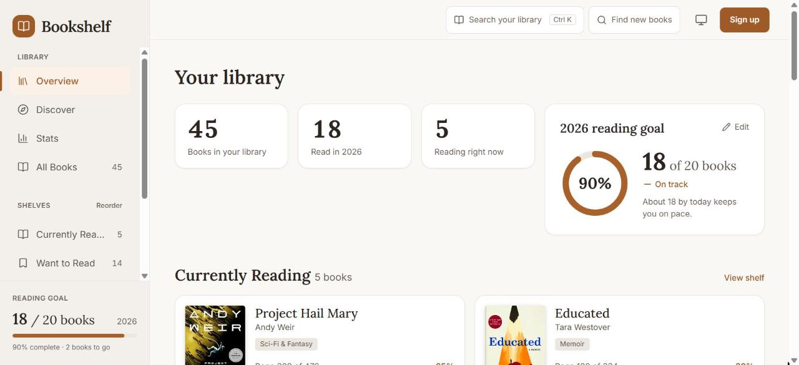

# Bookshelf (Personal Reading List challenge) — Iyanuoluwa Olajide

My solution to the Frontend Mentor **Personal Reading List** product challenge, published as **Bookshelf**: a personal reading tracker where you search for books, organize them into shelves, track reading progress, and explore year-in-review statistics.

**Live URL:** [bookshelf-reading-tracker.vercel.app/guest](https://bookshelf-reading-tracker.vercel.app/guest) · **Repo:** [Iyanu22/bookshelf-reading-tracker](https://github.com/Iyanu22/bookshelf-reading-tracker)



---

## Overview

Bookshelf is a warm, literary reading tracker built with Next.js and Supabase. Visitors can explore a fully populated library as a guest straight away, without creating an account. The guest library has 45 real books spread across shelves, with progress, ratings, notes and a year of reading history.

What you can do:

- **Find books:** search Open Library by title, author or ISBN, browse 13 genres, or start from six hand-curated lists. Books already in your library are flagged across editions.
- **Organize them:** use the three default shelves plus your own. Shelves can be renamed, deleted and reordered, and each has sorting and filters (genre, author, rating, shelf).
- **Track reading:** log progress with one tap (+10, +25 or +50 pages) or by typing a page number. You get an estimated finish date, milestone moments at 50% and 90%, and a prompt to mark the book as read on the last page.
- **Set a yearly goal:** see whether you're ahead of or behind pace.
- **Search your own library:** press ⌘K / Ctrl+K or `/` to search titles, authors and your own notes.
- **Explore your reading:** a statistics dashboard, plus a tap-through **Year in Review** story that ends on a summary card you can screenshot and share.

### Tech Stack

| Layer | Technology |
|-------|-----------|
| Framework | Next.js 16 (App Router, Turbopack, Cache Components) + React 19 + TypeScript |
| Database | Supabase Postgres with row-level security |
| Authentication | Supabase Auth (email + password) via `@supabase/ssr` |
| Book API | Open Library (search, covers) |
| Hosting | Vercel |
| Styling | Tailwind CSS v4 on the brand-kit design tokens, light + dark themes |
| Charts/Viz | Hand-built SVG/HTML charts (no chart library) |
| State | Zustand store with optimistic updates and rollback |
| Testing | Vitest unit tests for stats, progress estimates, library search, Year in Review planning and the store's rollback logic |
| Icons | Lucide |

---

## Design Decisions

These are the product and design choices I made where the spec left room for interpretation.

### Year-in-Review & Reading Insights

**The problem I was solving:**
A stats page is useful, but it isn't a *moment*. I wanted two things that pull in different directions:
- a place to dig into the numbers whenever you like;
- a once-a-year experience that feels like a reveal and leaves you with something worth sharing.

**My approach:**
I built two connected pieces.

1. **`/year-in-review`: a full-screen, tap-through story** (my chosen design).
   - It drops the app chrome entirely (its own route group with no sidebar) to mark it as a special occasion.
   - Each slide makes one point in large Lora type: books finished, pages read, top genre, busiest month, reading habit (days and longest streak), favourite book, shortest vs. longest book.
   - Slides are skipped when there's no data for them, so a light year never shows an empty slide.
   - The story ends on a **summary card**: a single calm composition designed to survive a screenshot.
   - Navigation: tap the right of the screen to go forward and the left third to go back, or use the arrow keys or space. Esc exits. The progress segments at the top are real buttons you can jump to.
2. **`/stats`: the everyday dashboard** (my differentiator, below). The story links to it for anyone who wants the detail.

**Why I chose this approach:**
- The story format is familiar from Spotify Wrapped and Instagram stories, so it needs no explanation.
- One idea per screen gives each number room to land. A dashboard can't do that.
- Ending on a summary card means the shareable artifact is designed on purpose rather than being a cropped screenshot of a chart.

**What I'd do differently:**
I'd generate the summary card as an image (via `next/og`) so it could be shared with one tap. I'd also add gentle slide transitions that still respect reduced-motion settings.

### Book Discovery & Recommendations

**The problem I was solving:**
A new reader with an empty library facing a blank search box doesn't know what to type. Search only works when you already know what you want.

**My approach:**
`/discover` combines two ways in:

- **Curated lists:** six hand-picked lists of six books each, such as "Voices from around the world", "Finish it this weekend" and "Books developers love". Each list has a short blurb explaining why it exists.
- **Genre browsing:** 13 genres, each showing Open Library's most-read books for that subject. Each result can be added in place, and books already in your library are marked.

An empty library links straight to Discover, so it doubles as onboarding.

**Why I chose this approach:**
- Curated lists give the page a voice and taste, which an algorithm can't do with an empty library to learn from.
- Genre browsing covers the "I just like fantasy" reader.

Two details on how the data behaves:

- **The curated lists are resolved at build time** by `scripts/build-curated-lists.mjs` and saved to JSON, not looked up on every visit.
  - Open Library's top search hit for a famous title is often the wrong edition, a translation, an omnibus or a sequel. The script scores candidates by title match, author surname, cover availability and edition count, and caches the result.
  - The result: every cover and edition in a list is correct and loads instantly.
- **Genre pages use search sorted by reading-log popularity**, not the subjects API. The subjects API returned too much noise. I dropped three genres (History, Philosophy, Graphic novels) entirely because even search couldn't give clean results for them.

**What I'd do differently:**
I'd add "because you read X" recommendations based on the reader's own shelves and ratings once their library has enough signal.

### Reading Progress Tracking UX

**The problem I was solving:**
Updating progress is the most frequent action in the app. If it takes more than a couple of seconds, people stop doing it and every statistic downstream goes stale.

**My approach:**
**Page entry plus quick buttons**, available both on the book page and on the "Currently reading" cards on the library overview.

- **Quick updates:** one tap adds +10, +25 or +50 pages, or +5/10/25% for books without a page count.
- **Exact updates:** a "Set page" field for when you want to be precise.
- **Rapid taps:** each update is a change from the latest saved value, so tapping several times quickly never loses an update.
- **Estimated finish date:** counted from today, based on your pace over the last three weeks (falling back to your average since you started). For example: "est. finish Nov 26".
- **Milestones:** at 50% and 90% a short message appears in place of the estimate line, so the buttons never move under your finger. Screen readers announce it.
- **Last page:** reaching the end offers "Mark as read" rather than moving the book to Read automatically.

**Why I chose this approach:**
Quick buttons make the common case ("I read a chapter") one tap, while page entry keeps exact tracking possible. The finish estimate is counted from today rather than from the last update, so it stays honest if you take a break.

**What I'd do differently:**
I'd add a "reading session" timer, and support for audiobooks and ebooks measured in minutes or location rather than pages.

### Other Design Choices

- **Brand-kit colours adjusted for accessibility.** Four tokens failed WCAG AA contrast, so I nudged them while keeping the hue:
  - Light-theme tertiary text: `#8c8278` → `#6e645b`.
  - Accent: `#a8612b` → `#9e5a27` (on the secondary background).
  - Dark-theme tertiary text: `#7a716a` → `#998e83`.
  - Success green (light theme): `#3d7c4f` → `#387349`, found by Lighthouse on the live landing page.
- **Missing covers.** Open Library returns an invisible 1×1 image for missing covers. I request covers with `?default=false` so a missing cover becomes a real 404. The app then shows a styled "book spine" placeholder in one of seven muted colours, chosen deterministically from the title, so it sits naturally among real covers.
- **Duplicate editions.** Books are matched across editions with a loose title and author signature, so adding a second edition of a book you already have shows "In your library, on Read" instead of creating a duplicate.
- **ISBN search.** A bare ISBN, with or without dashes, is detected and turned into an exact ISBN lookup.
- **Two clearly separate searches.** "Search your library" (instant, in memory, includes your notes) and "Find new books" (the Open Library catalogue) are labelled distinctly in the header. When a library search finds nothing, it offers to search the catalogue instead.
- **Accessible shelf reordering.** Reordering uses move-up and move-down buttons rather than drag-and-drop. It works identically with a mouse, keyboard, screen reader or touch, and each move is announced.
- **Genre tags reuse your own vocabulary.** Suggestions come from the tags already in your library, most-used first, and typing "classics" reuses your existing "Classics". This keeps the stats dashboard's genre chart clean.
- **Navigation.**
  - Desktop: a sidebar of shelves, with your goal at the bottom.
  - Mobile: a bottom tab bar (Library, Shelves, Discover, Search, Stats), with shelves opening as a bottom sheet.
- **Optimistic updates.** Every change appears instantly. If saving fails, it rolls back and a toast explains what happened.

---

## Development Journey

### Initial Approach vs. Final

The plan was a full-stack build from day one: Supabase for data and auth, with guest mode as a separate data source. That held up.

The app talks to a single `LibraryRepository` interface with two implementations:
- `GuestRepository`, which keeps the seeded library in session storage;
- `SupabaseRepository`.

As a result, every feature works identically for guests and signed-in readers, and guests never touch the database.

### Decisions Reconsidered

- **Finish estimate.** It was first calculated "as of the last update". I changed it to count from today, so the date doesn't sit frozen in the past when you haven't read for a while.
- **Genre browsing data source.** I moved from Open Library's subjects API to search sorted by popularity (the subjects API was too noisy) and cut three genres that couldn't be made clean.
- **Curated lists.** I moved from looking books up at runtime to resolving them at build time, after seeing how often the top search hit was the wrong edition.
- **Year in Review navigation.** The original tap buttons blocked the content on small screens. I replaced them with a whole-screen tap handler that ignores links and buttons.

### What Surprised Me

- How messy real book data is. Open Library has omnibus editions, translators listed as authors, and cover images that are technically present but blank.
- Next.js 16's Cache Components forbid reading the current time during render. Anything relative to "now" goes through a small shared clock hook (`useNow`), and the current year comes from the store. That forced a cleaner separation between data and time.
- Charts are mostly colour and accessibility work. The chart palette was checked with a colour-vision-deficiency validator, and every chart has a table view.

### Session Breakdown

| Session | Focus | What I Accomplished |
|---------|-------|-------------------|
| 1 | Foundation | Stack decisions, design tokens, guest seed, repository layer, Supabase schema + RLS, landing page, library, shelves, book detail, Open Library search |
| 2 | Design challenges | Reading progress UX, Discover (curated lists + genres) |
| 3 | Differentiator | Stats dashboard and Year in Review story |
| 4 | Core polish | Shelf reordering, library search (⌘K), genre tag editing |
| 5 | Ship | <!-- TODO: Supabase hookup, deployment, Lighthouse --> |

---

## AI Collaboration Reflection

<!-- TODO: rewrite this section in your own voice; it's a starting point based on how the sessions went. -->

### How I Used AI

I worked with Claude Code throughout, with `AGENTS.md` giving it the spec, brand kit and collaboration rules.
- **What Claude did:** most of the implementation. It also tested every feature in a real browser (desktop and 375px mobile, light and dark) before I committed.
- **What I decided:** the stack, the differentiator, and how each of the three design challenges should work. Claude asked about these before building anything.

### What Worked Well

- Keeping the design-it-yourself features as explicit decision points, with options presented side by side, rather than letting the AI pick.
- Small, reviewable commits per feature.
- Asking for verification in the browser rather than accepting "it compiles".

### What I Learned

<!-- TODO -->

### Where I Pushed Back

- The finish-date estimate originally measured from the last update. I asked for it to count from today instead.

---

## Differentiators

### Chosen Differentiator(s)

**1. Reading Statistics Dashboard**

**Why I chose this:**
Statistics are the payoff for tracking at all. They turn a list of books into a picture of you as a reader, and they're the foundation the Year in Review story is built on.

**How it enhances the product:**
`/stats` lets you look at any year, with year-over-year comparison:

- **Stat tiles:** books and pages read, average length and rating, and unique authors, each compared with the previous year where it helps.
- **Books finished per month**, with the previous year shown alongside as context.
- **Genre breakdown.**
- **A GitHub-style daily reading heatmap**, with reading days and longest streak.
- **Book length distribution.**
- **Ratings distribution.**
- **Time to finish.**
- **Highlights:** top-rated, longest and shortest books, and top authors.

**Implementation highlights:**
- **No chart library.** The charts are hand-built in SVG and HTML, which keeps the bundle small and gives full control over the brand look.
- **One emphasis colour.** Charts use copper for "this year" and a quiet grey for context.
- **Tested colours.** The palette was checked for contrast and colour-vision-deficiency separation in both light and dark themes.
- **Heatmap colours:** an ordered copper scale from light to dark, tuned separately for each theme.
- **Accessible to keyboard and screen-reader users:**
  - Every chart has a "Show as table" toggle.
  - Tooltips work on hover and keyboard focus, and you move between bars with the arrow keys.
  - Charts never rely on colour alone.
- **Pure calculation.** All the maths lives in one pure function, `computeYearStats`, which the dashboard and Year in Review share.

**What I learned:**
Most of the work in a chart is deciding what *not* to show: one axis, one emphasis colour, labels only where they help.

---

## Self-Assessment

<!-- TODO: fill in your own ratings -->

| Category | Rating | Notes |
|----------|--------|-------|
| **Works for real users** — Deployed, functional end-to-end | /5 | |
| **Book API integration** — Handles missing covers, varied ISBNs, inconsistent metadata | /5 | |
| **Design-it-yourself features** — Quality and thoughtfulness of year-in-review, discovery, and progress tracking solutions | /5 | |
| **Design quality** — Typography pairing, warm aesthetic, spacing, visual hierarchy, polish | /5 | |
| **Responsive design** — Fully functional and well-designed across devices | /5 | |
| **Performance** — Fast load, smooth scrolling, efficient cover image loading | /5 | |
| **Accessibility** — Keyboard nav, screen reader support, contrast | /5 | |
| **Edge case handling** — Empty states, errors, loading, missing data, large libraries | /5 | |
| **Code quality** — Clean, maintainable, well-structured | /5 | |
| **Landing page** — Compelling, communicates value, visually polished | /5 | |
| **Guest experience** — Immediately impressive, real books, full features | /5 | |

### Lighthouse Scores

Lighthouse 12, mobile profile (simulated slow 4G), run against the live site on 25 Nov 2026.

| Category | Landing `/` | Guest library `/guest` |
|----------|:---:|:---:|
| Performance | 98 | 77 |
| Accessibility | 100 | 100 |
| Best Practices | 100 | 100 |
| SEO | 100 | 100 |

**What moved the numbers:** Open Library covers redirect up to twice to archive.org, and one took 17.8 s to load. Routing covers through Next.js image optimization (fetched once, resized to the rendered size, served as WebP from Vercel's CDN for 31 days) took `/guest` from 66 to 77 (Speed Index 8.1 s → 4.0 s) and the landing page from 90 to 98. A contrast fix on the success green took landing accessibility from 96 to 100.

**What's left on `/guest`:** the guest library is built in the browser from the seed data, so the first paint waits on JavaScript (about 0.5 s of main-thread blocking). Rendering the guest shell on the server would be the next step.

### Strengths

- Guest mode is a complete, believable library from the first click, with a year of reading history behind it.
- Accessibility goes beyond the basics:
  - AA-adjusted colours.
  - Live announcements for progress, milestones, reordering and tag changes.
  - Table views for every chart.
  - 44px touch targets.
  - Reduced-motion support.

### Areas for Improvement

- Tests cover the logic (stats, progress, search, Year in Review planning, optimistic rollback) but not the UI. Component tests for the progress updater and an end-to-end guest-mode smoke test (Playwright) would be next.
- Goodreads CSV import (stretch feature) isn't built yet.
- Bulk actions on shelves (select several books, move or remove) aren't built yet.
- The Year in Review card could be a generated image for one-tap sharing.

---

## Known Limitations

- **Open Library limits:** it is rate-limited to roughly one request per second. Results are cached on the server and requests are throttled, but heavy searching can still see a brief "try again" message.
- **Page counts:** these come from Open Library's median across editions. When it has no page count, progress falls back to percentages.
- **Guest data is temporary:** the guest library lives in session storage and resets when the tab closes, which is by design for a demo.

---

## Running Locally

```bash
git clone https://github.com/Iyanu22/bookshelf-reading-tracker.git
cd bookshelf-reading-tracker
npm install

# Optional: without these the app runs in guest mode only
cp .env.example .env.local

npm run dev

# Unit tests
npm test
```

To enable accounts:
1. Create a Supabase project.
2. Fill in `.env.local`.
3. Run `supabase/migrations/0001_init.sql`, then `0002_grants.sql`, in the Supabase SQL editor. Together they create the tables, row-level security policies, a trigger that sets up default shelves for new users, and the shelf-deletion function.

To rebuild the curated Discover lists: `node scripts/build-curated-lists.mjs` (add `--refresh` to re-resolve every book).

### Environment Variables

| Variable | Description |
|----------|------------|
| `NEXT_PUBLIC_SUPABASE_URL` | Supabase project URL (Project Settings → API) |
| `NEXT_PUBLIC_SUPABASE_PUBLISHABLE_KEY` | Supabase publishable (anon) key; safe for the browser because RLS protects every table |

---

## Acknowledgments

Built for the [Frontend Mentor](https://www.frontendmentor.io) Personal Reading List product challenge. Book data and covers from [Open Library](https://openlibrary.org).
